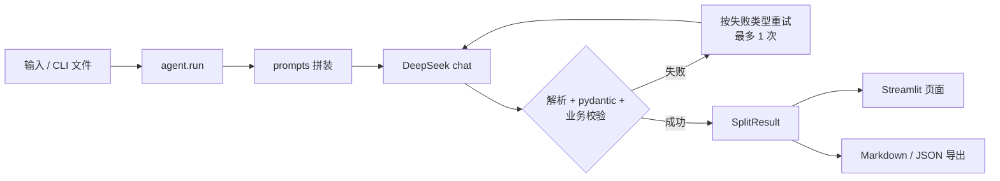

# dev-task-splitter

在本机运行的桌面工具：把粘贴进来的需求或缺陷描述，拆成「要做的任务 / 要测的点 / 要问清楚的问题」，可导出 JSON 与 Markdown。

它不是已上线产品，当前没有公开部署。

## 边界

- 只处理你粘贴的文本，不会读取代码仓库，也不会连接或写入工单系统；任务和问题需要你自己复制或下载后带走。
- 只面向电脑端浏览器，未适配手机。
- 只在本机运行，不提供对外访问地址。

## 功能

- 调用 DeepSeek 生成结构化 `SplitResult`，经 pydantic 与业务规则校验。
- 任务按优先级显示为高 / 中 / 低，附验收标准和依赖关系。
- 测试点关联到具体任务，覆盖功能、边界、错误处理、回归等类型。
- 待澄清问题单独列出；描述模糊时在顶部提示。
- 支持示例填入、复制 Markdown、下载 Markdown / JSON。
- 失败时显示中文错误；结果格式异常时同时显示原始输出，页面提供手动重试。
- 页面不展示工时估算（JSON 中仍保留该字段）。

## 运行

要求 Python 3.10+。

### 1. 获取代码

```bash
git clone https://github.com/zzhqqa478850-lang/dev-task-splitter.git
cd dev-task-splitter
```

仓库默认分支就是 `main`，克隆后直接使用，不需要切换其他分支。

### 2. 创建环境并安装依赖

```bash
python -m venv .venv
source .venv/bin/activate          # Windows: .venv\Scripts\activate
pip install -r requirements.txt
```

### 3. 配置 API key

浏览/打开页面不需要 key；只有点击「拆解」提交，以及命令行拆解，才需要 `DEEPSEEK_API_KEY`。

```bash
cp .env.example .env               # Windows: copy .env.example .env
```

编辑 `.env`，填入：

```text
DEEPSEEK_API_KEY=你的_key
```

也可以在环境变量中设置 `DEEPSEEK_API_KEY`（已存在的环境变量优先于 `.env`）。不要把真实密钥写进 README、代码或提交到 Git；`.env` 已在 `.gitignore` 中。

### 4. 启动页面

```bash
streamlit run app.py --server.address 127.0.0.1
```

默认端口 8501，页面只绑定本机回环地址，在本机浏览器打开 `http://127.0.0.1:8501` 即可。端口被占用时可加 `--server.port 8502`，地址相应改成 `http://127.0.0.1:8502`。这是本机地址，不是对外地址。

### 5. 可选：测试与命令行

```bash
# 单元测试：全部 mock，不访问网络
pytest -q

# 命令行拆解一个样例（需要 DEEPSEEK_API_KEY）
python -m splitter --input samples/S01_feature_coupon_redemption.txt
```

命令行把摘要、任务 / 测试点 / 问题数量和耗时打印到终端，不写文件；失败时返回非 0 并打印中文错误。

## 页面使用

1. 粘贴需求或缺陷描述，默认上限 3000 字（按去掉首尾空白后计算）。字数在页面重新运行后更新，提交时按同一规则校验。
2. 空内容点击「拆解」只提示「请先粘贴需求或 bug 描述。」，不会调用模型。超过 3000 字时提交按钮禁用，原文不截断。
3. 提交后，当前 Streamlit 会话会锁定输入、示例、拆解和重试，并清掉上一次结果。这个锁只对当前标签页的当前会话有效，不能跨标签、跨进程或跨 worker 去重。
4. 结果包括摘要、需求理解、任务、测试点、问题和自检。改了输入但未重新提交时，页面会标明结果仍属于上次提交。
5. 在「导出」区下载 Markdown / JSON，也可展开「一键复制 Markdown」复制。页面不显示工时估算，JSON 里仍有该字段。
6. 模型调用失败（包括未配置 key、鉴权失败）时显示错误文案和手动「重试」；页面层不会自动再发一次请求。空输入和超限属于提交前校验，不出现「重试」。

页面内置三个示例按钮，直接读取 `samples/` 下的原文：

- `S01_feature_coupon_redemption.txt`：需求类
- `S04_feature_vague_unclear.txt`：故意模糊的需求
- `S06_bug_coupon_list_500.txt`：缺陷反馈

## 结构



依赖方向：`app.py → agent.py → (prompts, llm_client, schema, validator)`；`render.py` 只依赖 `schema` 与 `config`，不调用模型。

```text
.
├── app.py                    # Streamlit 页面
├── splitter/
│   ├── __main__.py           # 命令行入口
│   ├── agent.py              # 主流程与重试
│   ├── config.py             # 配置、文案、API key 读取
│   ├── llm_client.py         # DeepSeek / OpenAI 兼容调用
│   ├── prompts.py            # system prompt 与 few-shot 拼装
│   ├── render.py             # SplitResult → Markdown
│   ├── schema.py             # pydantic 数据定义
│   └── validator.py          # JSON、schema 与业务规则校验
├── prompts/                  # 提示词与示例
├── samples/                  # 手动回归样例（只读）
├── eval/                     # 评测用例与评分材料
├── tests/                    # 单元测试（mock，不访问网络）
├── .streamlit/config.toml    # 页面主题
├── .env.example              # 环境变量模板（不含真实 key）
└── requirements.txt
```
