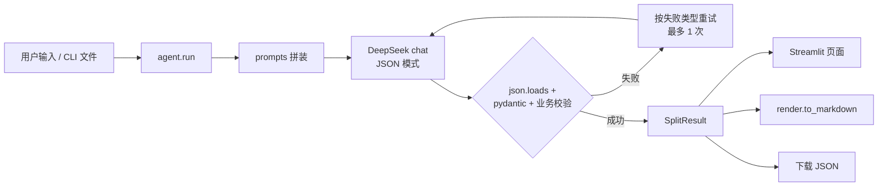

# dev-task-splitter

把杂乱的需求或 bug 描述，一键拆成「要做的任务 / 要测的点 / 要问清楚的问题」，并支持导出 JSON 与 Markdown。

## 功能

- 单次 DeepSeek 调用，输出结构化 `SplitResult`（pydantic 校验 + 业务规则检查）
- 任务按优先级展示为 **高 / 中 / 低**，并给出验收标准与依赖关系
- 测试点关联具体任务，覆盖功能、边界、错误处理、回归等类型
- 待澄清问题独立成块；输入模糊时顶部显示黄色提示
- 失败不崩溃：展示中文错误，JSON 解析失败时同时展示原始输出，可一键重试
- 支持示例一键填入、复制 Markdown、下载 Markdown / JSON

## 运行步骤

要求 Python 3.10+。

```bash
# 1. 创建并激活虚拟环境
python -m venv .venv
source .venv/bin/activate          # Windows: .venv\Scripts\activate

# 2. 安装依赖
pip install -r requirements.txt

# 3. 配置 API key：复制模板后填写，不要把 .env 提交到仓库
cp .env.example .env               # Windows: copy .env.example .env
# 编辑 .env，填入：
# DEEPSEEK_API_KEY=你的_key

# 4. 运行测试（全部使用 mock，不访问网络）
pytest -q

# 5. 命令行跑一条样例
python -m splitter --input samples/S01_feature_coupon_redemption.txt

# 6. 启动网页应用（默认 http://localhost:8501）
streamlit run app.py
```

API key 的读取顺序是：环境变量（含 `.env`）→ Streamlit `secrets`。页面不会显示 key。
使用 Streamlit Cloud 等部署环境时，可在 `.streamlit/secrets.toml`（已被 `.gitignore` 忽略）中配置：

```toml
DEEPSEEK_API_KEY = "你的_key"
```

## 页面使用

1. 在输入框粘贴需求或 bug 描述。字数按去掉首尾空白后的长度计算，上限 3000。Streamlit 不会在每个按键后立刻重跑脚本，所以字数在页面重新运行（失焦、点击按钮等）之后更新，并与提交时的校验一致。
2. 空内容仍可点击「拆解」，页面只提示「请先粘贴需求或 bug 描述。」，不会调用模型。超过 3000 字时主按钮禁用，原文不会被截断。
3. 点击「拆解」后，当前这次会话会锁住输入、示例、拆解和重试，并先清掉上一次的结果。这个锁只在当前浏览器标签的这一次 Streamlit 会话里有效，不能跨标签、跨进程或跨 worker 去重。
4. 查看摘要、需求理解、任务、测试点、问题与自检。若之后改了输入但还没再次提交，页面会标明结果仍属于上次提交。
5. 在「导出」区下载 Markdown / JSON，或展开「一键复制 Markdown」点击代码块右上角复制。页面不展示工时估算，JSON 里仍保留该字段。
6. 模型调用失败（含未配置 key、鉴权失败）时展示原来的错误文案和手动「重试」。页面不会再自动打一次。空输入和超限是提交前校验，不出现「重试」。

页面内置三个样例的一键填入按钮，均直接读取 `samples/` 下的原文：

- `S01_feature_coupon_redemption.txt`：需求类
- `S04_feature_vague_unclear.txt`：故意模糊的需求
- `S06_bug_coupon_list_500.txt`：bug 反馈

## 架构



依赖方向：`app.py → agent.py → (prompts, llm_client, schema, validator)`；`render.py` 只依赖 `schema` 与 `config`，不调用模型。

```text
.
├── app.py                    # Streamlit 入口
├── splitter/
│   ├── agent.py              # 主流程与重试
│   ├── config.py             # 配置、文案、API key 读取
│   ├── llm_client.py         # DeepSeek / OpenAI 兼容调用
│   ├── prompts.py            # system prompt 与 few-shot 拼装
│   ├── render.py             # SplitResult → Markdown
│   ├── schema.py             # pydantic 数据定义
│   └── validator.py          # JSON、schema 与业务规则校验
├── prompts/                  # 提示词与示例
├── samples/                  # 手动回归样例（只读）
├── tests/                    # 单元测试（mock，不访问网络）
├── .env.example              # 环境变量模板（不含真实 key）
└── requirements.txt
```

## 截图与 Demo

- 页面截图：**待补**（尚未添加截图文件）。
- 在线 Demo：**待补**（暂无公开部署链接）。

> 本仓库不会提交 `.env`、真实 API key 或 Streamlit secrets 文件。
